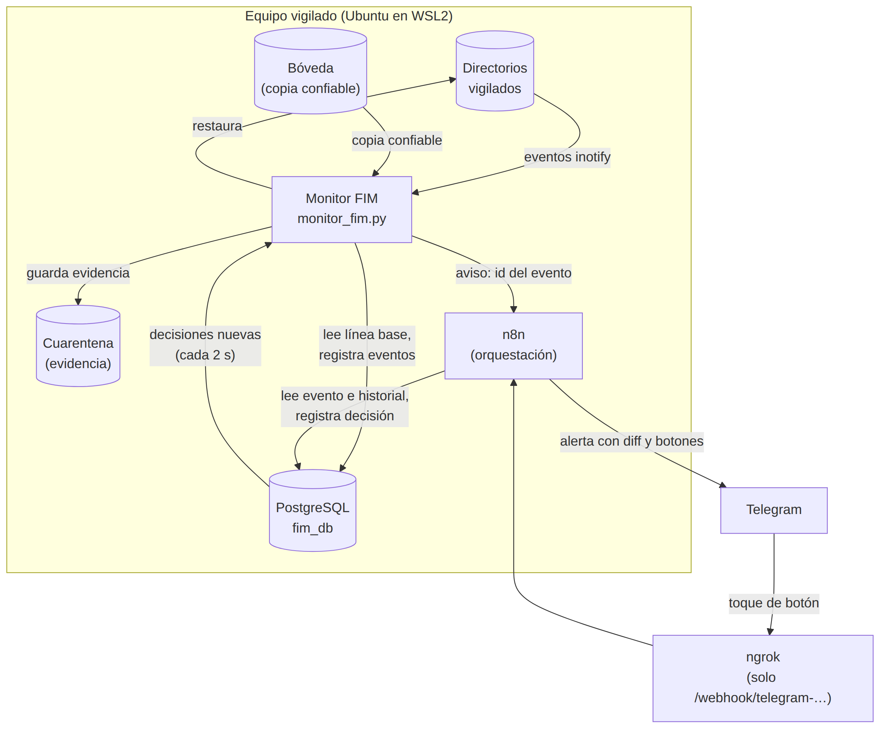

# Sistema FIM con extracción diferencial y orquestación n8n

Trabajo Final Integrador de la Tecnicatura Universitaria en Programación (UTN, Facultad Regional
Mendoza). Autor: Rodrigo Jesús Noguerol.

## Qué es

Un monitor de integridad de archivos (FIM) para Linux que detecta en tiempo real cualquier cambio en
los directorios vigilados, registra el diff exacto de lo que cambió en PostgreSQL y restaura el
archivo desde una copia confiable. Las alertas llegan por Telegram y la persona decide con un botón
si fue un incidente o un cambio autorizado; esa decisión la orquesta n8n y la ejecuta el monitor.

## Estado del proyecto

El código se congeló en el commit `81b1bc8` (16/10/2026) para la primera entrega del TFI, y sobre
ese commit se hicieron las mediciones de octubre.

Después de la devolución del tribunal (17/11/2026) se corrigió un defecto de seguridad de la
restauración y el tratamiento de los enlaces simbólicos. El código de la aplicación quedó **cerrado
en el commit `39c661c`** (17/11/2026). Qué cambió entre uno y otro:

- El temporal de la restauración tiene nombre aleatorio y se crea con apertura exclusiva
  (`tempfile.mkstemp`); antes era `.fim_tmp_<nombre>` y la restauración seguía enlaces simbólicos.
- El monitor ya no ignora los archivos por el prefijo `.fim_tmp_`: solo ignora los temporales que él
  mismo tiene creados en ese momento.
- Los enlaces simbólicos no se siguen. Un archivo de la baseline reemplazado por un enlace se
  detecta y se repone; un enlace nuevo se registra y se elimina (en modo aprobación, espera la
  decisión). `generar_baseline.py` saltea los enlaces y avisa.
- El hash, el diff y la copia a cuarentena salen de una sola apertura del archivo (`O_NOFOLLOW`), y
  los permisos se reponen sobre el descriptor (`fchmod`, `fchown`).
- Antes de restaurar se comprueba que la carpeta real del archivo siga dentro del directorio vigilado.
- `restaurar.py` y el monitor comparten un candado (`flock` sobre `logs/monitor.lock`).

**No apuntar el monitor a directorios con enlaces simbólicos legítimos (por ejemplo `/etc`):** los
enlaces no entran en la baseline y el monitor los elimina. Esta y las demás limitaciones están en la
sección 6.4 del informe.

Las mediciones de octubre y las que se repitieron sobre `39c661c` están en
[`resultados/`](resultados/), cada una con su fecha.

## Arquitectura



| Componente | Qué hace |
|---|---|
| `generar_baseline.py` | Recorre los directorios vigilados, calcula SHA-256, propietario y permisos de cada archivo, los registra como baseline en la BD y copia cada archivo a la bóveda. |
| `monitor_fim.py` | Recibe los eventos de inotify (watchdog), compara el disco con la baseline vigente, registra el evento con su diff, guarda la evidencia en cuarentena y restaura desde la bóveda. Cada 2 s ejecuta las decisiones que n8n dejó en la BD. |
| PostgreSQL (`fim_db`) | Registro de solo-agregar: baseline versionada, eventos, decisiones y ejecuciones. El agente (`fim_user`) solo puede leer e insertar. |
| n8n | Recibe el aviso de cada evento, arma la alerta con el diff y la manda por Telegram, y registra la decisión de la persona. **Nunca toca archivos ni corre comandos.** |
| Telegram + ngrok | Botones para decidir desde el celular. ngrok publica una sola ruta, con sufijo aleatorio y secreto. |

Módulos auxiliares: `boveda.py` (copia confiable y restauración atómica), `bd.py` (conexión),
`hashes.py`, `metadatos.py`, `filtros.py` (temporales de editores y temporales propios de la
restauración, que se ignoran), `notificador.py`
(aviso a n8n), `pendientes.py` (log local si la BD no responde) y `restaurar.py` (restauración
manual con aprobación).

## Requisitos

- Ubuntu (se desarrolló y midió en Ubuntu 24.04 sobre WSL2). El proyecto tiene que vivir en el
  sistema de archivos de Linux, no en `/mnt/c/...`: inotify no recibe eventos fiables del lado Windows.
- Python 3.12 y `python3-venv`.
- PostgreSQL 16 local.
- Para la orquestación: Node 24 (vía nvm) y n8n 2.41.4; un bot de Telegram.
- Opcional, para los botones de Telegram desde cualquier lado: una cuenta gratuita de ngrok.

Las dependencias de Python están fijadas en [`requirements.txt`](requirements.txt).

## Instalación paso a paso

Todos los comandos se corren desde la raíz del proyecto.

### 1. PostgreSQL

```bash
sudo service postgresql start          # en WSL los servicios no arrancan solos
sudo -u postgres psql -c "CREATE ROLE fim_user LOGIN;" -c "CREATE DATABASE fim_db OWNER fim_user;"
sudo -u postgres psql -c '\password fim_user'   # pide la clave sin mostrarla
```

### 2. Entorno de Python

```bash
python3 -m venv venv
source venv/bin/activate
pip install -r requirements.txt
```

### 3. Configuración (`.env`)

```bash
cp .env.example .env
```

Editar `.env` y completar `DB_PASS` con la clave del paso 1. El resto tiene valores por defecto que
sirven para la demo: se vigila `./directorio_prueba` y la bóveda, la cuarentena y los logs quedan
en la carpeta del proyecto. Los secretos de n8n y Telegram se completan en el paso 6.
El `.env` está en `.gitignore` y nunca se versiona.

### 4. Migraciones de la base

Las cuatro primeras se aplican como `fim_user`; las dos últimas pasan la propiedad de las tablas a
`postgres` para que el agente no pueda modificar ni borrar el historial, así que se corren como
superusuario (y por entrada estándar, porque `postgres` no puede leer dentro de `/home`):

```bash
for m in 01_schema 02_baseline_versionada 03_fecha_con_zona 04_evidencia; do
    psql -v ON_ERROR_STOP=1 -h localhost -U fim_user -d fim_db -f sql/$m.sql
done
sudo -u postgres psql -v ON_ERROR_STOP=1 -d fim_db < sql/05_permisos_minimos.sql
sudo -u postgres psql -v ON_ERROR_STOP=1 -d fim_db < sql/06_orquestacion.sql
sudo -u postgres psql -d fim_db -c '\password fim_n8n'   # clave del rol que usa n8n
```

Cada archivo de [`sql/`](sql/) explica en su cabecera qué cambia y por qué.

### 5. Baseline inicial

```bash
python generar_baseline.py
```

Si `directorio_prueba/` no existe, lo crea con un archivo de ejemplo. Hay que volver a correrlo
cada vez que cambien las rutas de `RUTAS_MONITOREADAS`.

Con esto el monitor ya funciona solo (detecta, registra, aísla y restaura). Los pasos 6 y 7 agregan
las alertas y la decisión humana.

### 6. n8n y Telegram

La guía completa está en [`n8n/README.md`](n8n/README.md). En resumen:

1. Instalar Node 24 con nvm y `n8n@2.41.4` (sección 1 de esa guía).
2. Crear un bot con `@BotFather` y completar en `.env`: `TELEGRAM_BOT_TOKEN`, `TELEGRAM_CHAT_ID`
   (el id numérico de tu cuenta), `N8N_WEBHOOK_URL=http://localhost:5678/webhook/fim-evento` y
   los secretos `N8N_WEBHOOK_SECRETO`, `TELEGRAM_WEBHOOK_SECRETO` y `TELEGRAM_WEBHOOK_SUFIJO`
   generados con `openssl rand -hex 24` (el sufijo, con `-hex 16`).
3. Arrancar n8n, crear la cuenta dueña y las dos credenciales (`Telegram FIM` y
   `Postgres FIM (fim_n8n)`) en <http://localhost:5678>:

   ```bash
   ./n8n/iniciar_n8n.sh
   ```

4. Detener n8n (Ctrl+C), importar los workflows y volver a arrancarlo:

   ```bash
   ./n8n/importar_workflows.sh
   ./n8n/iniciar_n8n.sh
   ```

n8n arranca con un entorno limpio: del `.env` solo recibe el chat_id y los secretos de los webhooks,
nunca la clave de la BD ni el token del bot. Los datos de n8n quedan en `~/n8n_fim`, fuera del repo.

### 7. Botones de Telegram desde cualquier lado (opcional)

Sin este paso las alertas igual llegan, con links locales para decidir desde la PC. Para que los
botones funcionen desde el celular hace falta el túnel (sección 5 de `n8n/README.md`):

```bash
./n8n/iniciar_ngrok.sh                 # terminal aparte
./n8n/registrar_webhook_telegram.sh
```

## Demo mínima

Con PostgreSQL arriba, el venv activado y la baseline generada (pasos 1 a 5):

```bash
# Terminal 1: el monitor
python monitor_fim.py

# Terminal 2: un cambio no autorizado
echo "linea agregada por un atacante" >> directorio_prueba/config_test.txt
```

En la terminal 1 se ve el evento `MODIFICADO` con el diff, la copia a cuarentena y la restauración
desde la bóveda. Para comprobarlo:

```bash
cat directorio_prueba/config_test.txt   # volvió al contenido de la baseline
ls cuarentena/                          # la versión alterada quedó como evidencia
psql -h localhost -U fim_user -d fim_db -c \
  "SELECT id, evento, nombre_archivo, fecha_registro FROM registros_archivos ORDER BY id DESC LIMIT 3;"
```

Si además está n8n corriendo (paso 6), en segundos llega a Telegram la alerta con el diff y los
botones *Fue un incidente* / *Era un cambio autorizado*. Al tocar uno, el monitor ejecuta la
decisión y n8n confirma por Telegram.

Otras pruebas: crear un archivo nuevo en `directorio_prueba/` (va a cuarentena), borrarlo (se
restaura) o cambiarle los permisos con `chmod` (se reponen). Con `MODO_RESTAURACION=aprobacion` en
el `.env`, el monitor registra y guarda la evidencia pero espera la decisión antes de restaurar.

## Tests

```bash
pytest
```

Son 196 tests (193 de la aplicación y 3 del script de intervalos de confianza). Los del monitor usan una baseline en memoria y no necesitan base de datos. Los de
conexión se saltean si PostgreSQL no está. `tests/test_integracion_bd.py` usa una base aparte,
`fim_pruebas`, que se prepara con `scripts/preparar_bd_pruebas.sh`; nunca toca `fim_db`.

## Mediciones

Los resultados medidos están en [`resultados/`](resultados/): los CSV tal como salieron de los
scripts, los resúmenes (media, mediana, p95, mínimo y máximo), los gráficos y el entorno de cada
corrida. La lectura completa está en [`resultados/README.md`](resultados/README.md). Medianas de la
corrida de octubre (commit `81b1bc8`); la comparación con las corridas sobre `39c661c` está en la
sección 6 de ese README:

| Métrica | Mediana |
|---|---|
| Tiempo de detección (MTTD) | 5,4 ms |
| Tiempo de restauración (MTTR) | 45,4 ms (casi todo es el COMMIT de PostgreSQL) |
| Alerta en Telegram | 125 ms con Telegram simulado, 1,1 s con el bot real |
| Ejecución de una decisión | 0,9 s (sondeo cada 2 s) |
| Proporción de alertas espurias al editar con vim y nano | 0 % con el filtro de temporales, 50–67 % sin él |

Los scripts que las producen están en [`scripts/`](scripts/) (`medir_metricas.py`,
`medir_falsos_positivos.py`, `medir_escaneo_periodico.py`, `resumir_metricas.py`). Corren contra
`fim_pruebas` y un n8n descartable con Telegram simulado, salvo la muestra con el bot real.

## Informe

- [`docs/informe/`](docs/informe/): capítulos del informe final en Markdown (`00_resumen.md` a
  `09_anexos.md`) y el documento armado, `TFI_Noguerol_2026.docx`, que se genera con
  `docs/informe/armar_docx.py` (dependencias en `requirements-informe.txt`).
- [`docs/Informe de Avance.pdf`](docs/Informe%20de%20Avance.pdf): el informe de avance entregado.
- Las limitaciones conocidas están en el capítulo 6 del informe (sección 6.4).
