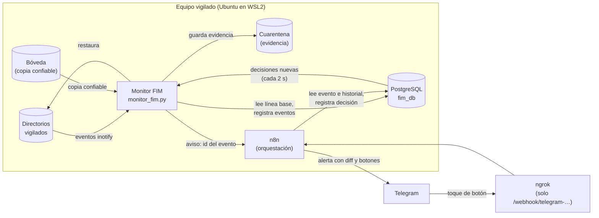
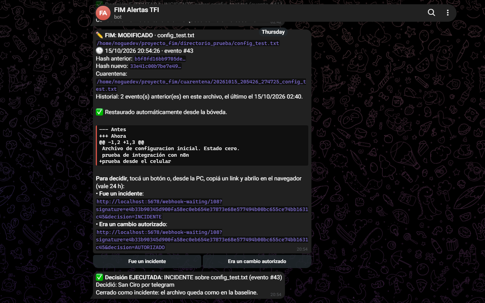
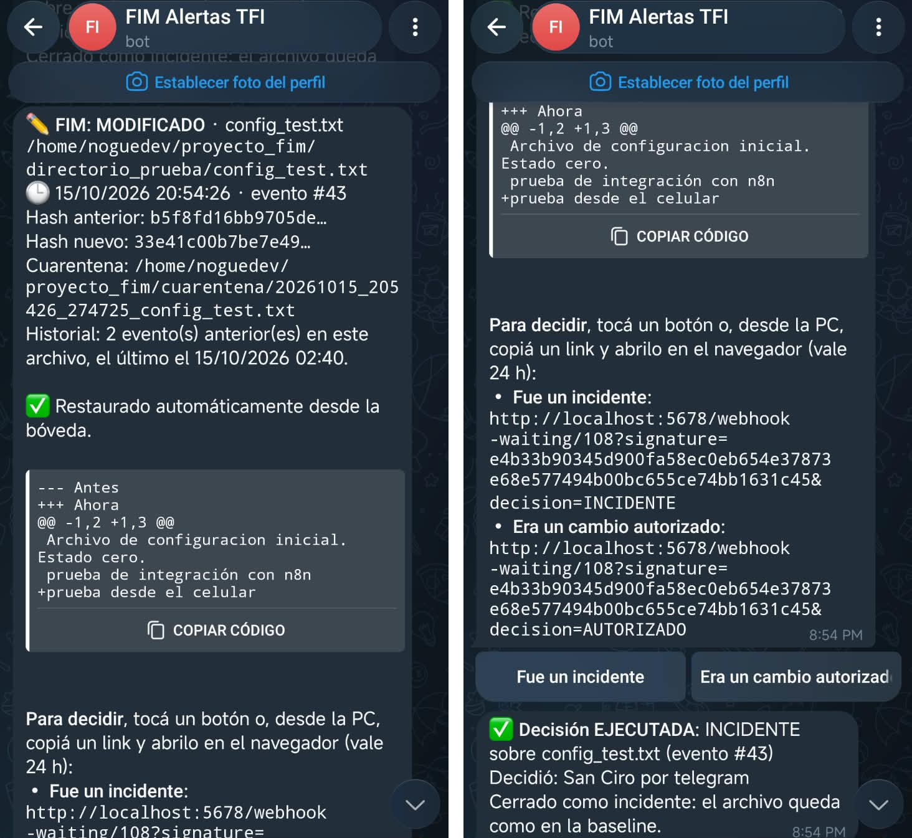

# CAPÍTULO 4: Desarrollo

Este capítulo describe cómo se construyó el sistema en su versión final: el punto de partida
documentado en el informe de avance, los problemas detectados en esa versión y la arquitectura que
los resuelve. Se explican las decisiones de diseño principales y sus motivos, porque varias de ellas
condicionan los resultados del Capítulo 5. El código fuente completo está en el repositorio del
proyecto; los fragmentos y datos que se citan corresponden a la versión congelada el 16 de octubre
de 2026.

## 4.1 Punto de partida: la versión del informe de avance

La versión presentada en el informe de avance estaba formada por dos scripts. `generar_baseline.py`
recorría un directorio de prueba, calculaba el hash SHA-256 de cada archivo junto con su propietario
y sus permisos, y guardaba esos datos en PostgreSQL como "Estado Cero". `monitor_fim.py` escuchaba
los eventos de modificación con la biblioteca watchdog, guardaba en memoria (RAM) el contenido de
los archivos, calculaba el diff contra esa copia y registraba la alteración en la base de datos.
Después del informe se le agregó una primera respuesta automática: el archivo alterado se movía a
una carpeta de cuarentena y se volvía a escribir con el contenido que estaba en memoria.

Antes de ampliar el sistema se realizó un diagnóstico de esa versión, que incluyó pruebas
controladas sobre una copia del monitor. Se detectaron los siguientes problemas:

- **La restauración dañaba lo que debía proteger.** Como la copia se guardaba en memoria como texto,
  un archivo binario restaurado quedaba con otro contenido y otro hash. Un script ejecutable perdía
  el permiso de ejecución, porque se creaba un archivo nuevo con los permisos por defecto. Un archivo
  nuevo, que no tenía copia previa, quedaba vacío.
- **El respaldo no sobrevivía a un reinicio.** Si el monitor se reiniciaba, la copia en memoria se
  perdía; peor aún, al arrancar tomaba como "original" lo que hubiera en disco, aunque ya estuviera
  alterado.
- **Solo se detectaban modificaciones de contenido.** El borrado, el movimiento de archivos, la
  creación de archivos nuevos y el cambio de permisos no dejaban ningún registro.
- **La línea base de la base de datos no se usaba.** El monitor nunca la consultaba; comparaba solo
  contra su copia en memoria. Además, cada ejecución del escáner agregaba otra línea base del mismo
  archivo, sin indicar cuál era la vigente.
- **Problemas menores:** se abría una conexión a la base de datos por cada evento, la carpeta de
  cuarentena no se creaba si no existía, las copias en cuarentena terminaban siempre en `.txt` y la
  fecha se guardaba sin zona horaria.

El desarrollo posterior se organizó en cuatro etapas, cada una formada por cambios pequeños y
verificables (un cambio por commit): las mejoras del motor, la orquestación con n8n, la medición y la
redacción de este informe. Entre el primer commit, el 12 de octubre de 2026, y el congelamiento del
código, el 16 de octubre, el repositorio acumuló 50 commits.

## 4.2 Arquitectura general

La Figura 4.1 muestra los componentes del sistema y cómo se comunican.

**Figura 4.1.** Arquitectura del sistema. El monitor es el único componente que modifica archivos;
n8n solo lee la base de datos, registra decisiones y se comunica con Telegram.

Los componentes son:

- **Monitor FIM (`monitor_fim.py`).** Proceso residente que recibe los eventos del sistema de
  archivos, compara cada archivo con la línea base, registra lo ocurrido, guarda la evidencia y
  responde (restaura, aísla o espera una decisión). También ejecuta las decisiones humanas.
- **Generador de línea base (`generar_baseline.py`).** Registra el estado de referencia de cada
  archivo y guarda una copia confiable en la bóveda.
- **Bóveda.** Carpeta con una copia de cada archivo de la línea base, desde la cual se restaura.
- **Cuarentena.** Carpeta donde se guarda una copia de cada archivo alterado como evidencia.
- **PostgreSQL.** Guarda la línea base, el registro de eventos y las tablas de la orquestación.
- **n8n.** Plataforma de automatización que recibe los avisos del monitor, arma y envía las alertas,
  y registra la decisión de la persona.
- **Telegram y ngrok.** Canal de alerta y, mediante el túnel de ngrok, vía de retorno de los botones
  de decisión.

El código del motor está repartido en módulos con una responsabilidad cada uno: `config.py`
(configuración desde el archivo `.env`), `bd.py` (conexión a la base de datos), `boveda.py` (copia y
restauración), `hashes.py` (SHA-256), `metadatos.py` (propietario y permisos), `filtros.py`
(archivos ignorados), `pendientes.py` (registro local cuando la base de datos no responde),
`notificador.py` (aviso a n8n) y `restaurar.py` (restauración manual).

## 4.3 Línea base y bóveda

### Línea base versionada

La línea base es el conjunto de filas `BASELINE` de la tabla `registros_archivos`, cada una con la
ruta absoluta del archivo, su hash SHA-256, sus permisos y su propietario. Para resolver el problema
de las líneas base duplicadas se agregó una columna `version_baseline`: cada ejecución de
`generar_baseline.py` inserta todos los archivos con un número de versión nuevo, y una vista,
`baseline_vigente`, devuelve las filas de la versión más alta. Las versiones anteriores no se borran
ni se modifican: quedan como historial.

Se eligió el versionado en lugar de borrar o actualizar las filas anteriores para mantener el
registro de solo-agregar (sección 4.5). Por el mismo motivo, cuando una persona acepta un cambio en
un archivo, no se rehace toda la línea base: la función `actualizar_archivo()` crea una versión nueva
que copia sin cambios las filas vigentes de los demás archivos y agrega solo la del archivo aceptado.
Así, aceptar el cambio de un archivo no acepta de rebote otro cambio pendiente en otro archivo.

### Bóveda y restauración atómica

La bóveda reemplaza a la copia en memoria. Al registrar la línea base, cada archivo se copia con
`shutil.copy2`, que conserva los bytes exactos, los permisos y las fechas. La copia se guarda
replicando la ruta absoluta del archivo dentro de la bóveda.

Para restaurar, el archivo se copia desde la bóveda a un archivo temporal en la misma carpeta y luego
se renombra sobre el original con `os.replace`. El renombrado es una operación atómica del sistema
de archivos, de modo que el archivo vigilado nunca queda faltante ni a medio escribir. Los archivos
temporales llevan el prefijo `.fim_tmp_` y el monitor los ignora.

Como la bóveda está en el mismo equipo, un atacante con acceso podría alterarla para que el monitor
"restaure" un contenido malicioso. Para mitigarlo, antes de restaurar se verifica que la copia de la
bóveda tenga el mismo hash que la línea base guardada en la base de datos. Si no coincide, el
archivo no se restaura, se guarda la evidencia y el evento queda registrado con la marca "bóveda no
confiable". Esta verificación se probó alterando la bóveda a propósito. La mitigación es parcial: en
un entorno productivo la bóveda debería estar en otro equipo o pertenecer a otro usuario.

## 4.4 Motor de monitoreo

### El evento como disparador

El monitor escucha los cuatro tipos de evento que entrega watchdog: creación, modificación, borrado
y movimiento. La decisión de diseño central es que **el evento es solo el disparador**: ante
cualquier evento, la función `procesar()` lee el estado real del archivo (si existe, su hash, sus
permisos y su propietario) y lo compara con la línea base vigente en la base de datos. Lo que se
registra surge de esa comparación y no del tipo de evento recibido.

Esta decisión tiene tres consecuencias:

1. Un mismo cambio puede producir varios eventos del sistema operativo (por ejemplo, truncar y
   escribir), pero se registra una sola vez, porque después de la primera respuesta el archivo vuelve
   a coincidir con la línea base.
2. Los eventos que genera el propio monitor al restaurar se descartan solos por el mismo motivo.
3. Un reemplazo por renombrado, como el que hacen `sed -i` y varios editores, se detecta como
   modificación del contenido, porque lo que se compara es el estado final del archivo.

**Tabla 4.1.** Clasificación y respuesta según el estado del archivo.

| Estado frente a la línea base | Evento registrado | Respuesta automática |
|---|---|---|
| Existe y su hash cambió | `MODIFICADO` | Copia a cuarentena y restauración desde la bóveda |
| Mismo contenido, pero cambiaron permisos o propietario | `PERMISOS` | Se reponen permisos y propietario (`chmod`, `chown`) |
| Figura en la línea base y no está en disco | `ELIMINADO` | Restauración desde la bóveda |
| Igual que el anterior, pero el disparador fue un movimiento | `MOVIDO` (con el destino) | Restauración desde la bóveda |
| Existe y no figura en la línea base | `CREADO` | Se mueve a cuarentena |
| Coincide con la línea base | (nada) | Ninguna |

Cada restauración agrega una fila `RESTAURADO`, que permite medir el tiempo de restauración y auditar
lo que hizo el sistema. Los permisos se guardan en octal incluyendo el cuarto dígito cuando el
archivo tiene los bits especiales (setuid, setgid o sticky), porque agregar setuid a un ejecutable es
un cambio de seguridad relevante que la versión anterior no registraba. Reponer el propietario
requiere ejecutar el monitor como superusuario; sin esos privilegios, el cambio se registra pero no
se repone.

### Evidencia

Por cada cambio se guarda una copia del archivo alterado en la cuarentena, con la fecha y la hora en
el nombre y conservando su extensión. Para los archivos de texto se calcula el diff contra la copia de
la bóveda con `difflib.unified_diff`; los archivos binarios no generan diff de texto y se deja
constancia de ello. Cada fila de evento guarda el hash anterior (el de la línea base), el hash nuevo,
el diff y la ruta de la copia en cuarentena.

El monitor guarda la evidencia en la base de datos **antes** de restaurar. Se priorizó que el registro
quede asentado aunque la restauración falle, a costa de que el tiempo de restauración incluya la
confirmación de esa escritura en la base de datos. Como se muestra en el Capítulo 5, en el entorno de
medición esa confirmación es el componente principal del tiempo de restauración.

### Escaneo inicial y archivos ignorados

Al arrancar, el monitor compara todos los archivos de la línea base, y los que haya en disco, contra
la línea base. Así detecta lo que cambió mientras estaba apagado, una ventana que un monitor
basado solo en eventos no cubre. Primero se empieza a escuchar eventos y después se escanea, para no
dejar un intervalo sin cobertura; un candado hace que los archivos se procesen de a uno. El monitor no
arranca si la línea base vigente no tiene archivos de las rutas configuradas, porque en ese caso
todo parecería un archivo nuevo y terminaría en cuarentena.

Los archivos temporales de los editores (`*.swp`, `*.swo`, `*.swx`, `*~`, `*.tmp`, configurables) no
se vigilan ni entran en la línea base. Su efecto sobre los falsos positivos se midió en el
Capítulo 5. El costo es que un archivo malicioso con uno de esos nombres no se detecta.

### Modos de restauración y ventanas de mantenimiento

La restauración automática tiene una ventaja clara, que es su rapidez, y un riesgo: revierte también
los cambios legítimos de un administrador. Para equilibrarlo se implementaron dos mecanismos:

- **Modo de restauración configurable.** En modo `automatica` (por defecto) el monitor restaura
  apenas detecta el cambio. En modo `aprobacion` registra el evento y guarda la evidencia, pero no
  restaura hasta que una persona lo decide. Los archivos nuevos van a cuarentena en ambos modos,
  porque el aislamiento es una contención reversible.
- **Ventanas de mantenimiento.** Antes de responder, el monitor consulta si hay una ventana vigente
  que cubra la ruta del archivo. Si la hay, registra el cambio con su diff y una copia en cuarentena,
  pero no lo restaura. Si las ventanas no se pueden consultar, se considera que no hay autorización y
  el monitor responde normalmente.

En ambos casos la decisión final queda en manos de una persona (sección 4.6).

### Funcionamiento con la base de datos caída

Sin acceso a la base de datos no hay línea base contra la cual decidir si un cambio es legítimo. Por
eso, en ese caso el monitor no restaura: copia el archivo alterado a la cuarentena y deja el evento,
con su diff contra la bóveda, en un registro local (`logs/eventos_pendientes.jsonl`). Si lo que falla
es solo la inserción de un evento ya verificado, el evento también queda en ese registro. La
reinserción automática de esos eventos cuando vuelve la base de datos no se implementó.

## 4.5 Modelo de datos y permisos

Los cambios de esquema se aplicaron como migraciones numeradas, sin modificar el esquema original.

**Tabla 4.2.** Migraciones de la base de datos.

| Migración | Contenido |
|---|---|
| `01_schema.sql` | Esquema original exportado con `pg_dump`: tabla `registros_archivos` |
| `02_baseline_versionada.sql` | Columna `version_baseline`, índice único (ruta, versión) y vista `baseline_vigente` |
| `03_fecha_con_zona.sql` | `fecha_registro` como `TIMESTAMPTZ`, con la conversión de las filas existentes |
| `04_evidencia.sql` | Columnas `hash_anterior` y `ruta_cuarentena` |
| `05_permisos_minimos.sql` | La tabla, la vista y la base pasan a pertenecer al superusuario; la cuenta del monitor queda con permisos mínimos |
| `06_orquestacion.sql` | Tablas de la orquestación y rol de n8n |

Todas las tablas son de **solo-agregar**: ningún componente actualiza ni borra filas. La migración
05 lo hace cumplir para la cuenta del monitor. No alcanzaba con revocar permisos, porque el dueño de
una tabla siempre puede devolvérselos y el dueño de la base puede borrar cualquier tabla del esquema
público; por eso la tabla, la vista y la base pasaron a pertenecer al superusuario de PostgreSQL. La
inmutabilidad vale entonces para las cuentas de la aplicación, no para el superusuario.

**Tabla 4.3.** Permisos de cada cuenta de base de datos.

| Cuenta | Lee | Agrega filas | Modificar o borrar |
|---|---|---|---|
| `fim_user` (monitor y línea base) | `registros_archivos`, `baseline_vigente`, `decisiones`, `ventanas_mantenimiento`, `ejecuciones`, `notificaciones` | `registros_archivos`, `ejecuciones` | No |
| `fim_n8n` (n8n) | `registros_archivos`, `baseline_vigente`, `notificaciones`, `decisiones`, `ejecuciones`, `ventanas_mantenimiento` | `notificaciones`, `decisiones`, `ventanas_mantenimiento`, `accesos_rechazados` | No |

La separación hace que lo ocurrido en los archivos (`registros_archivos` y `ejecuciones`) solo lo
pueda registrar el monitor, y que lo decidido por las personas (`decisiones`) solo lo pueda
registrar n8n. La tabla `decisiones` admite una sola fila por evento: si llegan dos decisiones sobre
el mismo evento por canales distintos, la base de datos rechaza la segunda. Los permisos se
verifican con pruebas automatizadas que consultan el catálogo de PostgreSQL.

## 4.6 Orquestación con n8n

La etapa de orquestación se basó en el documento de diseño de playbooks, con un ajuste de
arquitectura: **n8n orquesta y decide, pero no ejecuta**. n8n no modifica archivos ni ejecuta
comandos en el equipo: registra la decisión de la persona en la base de datos, y el monitor, que es
el componente que ya tiene permisos sobre los archivos, la ejecuta. De esta manera no fue necesario
habilitar en n8n la ejecución de comandos del sistema (deshabilitada por defecto en la versión
utilizada), y se eliminó la posibilidad de que un nombre de archivo malicioso termine interpretado
como parte de un comando.

### Aviso del monitor (arquitectura push)

Después de cada evento, el monitor envía a n8n un pedido HTTP con un único dato relevante: el
identificador del evento y el resultado de la respuesta. El pedido lleva un encabezado con un secreto
compartido; si el secreto no coincide, n8n responde con el código 403 y no procesa nada. Toda la
información de la alerta (archivo, hashes, diff, historial) la lee n8n de la base de datos, de modo
que un aviso falso no puede inventar contenido. El aviso se envía en un hilo aparte y con un tiempo
máximo de espera de 2 s, después de haber respondido al cambio, para que no demore la detección ni la
restauración.

### Playbooks implementados

Se implementaron cuatro flujos de trabajo (workflows) de n8n, exportados en la carpeta `n8n/` del
repositorio sin credenciales ni secretos:

- **PB-B, detección y respuesta (29 nodos).** Recibe el aviso del monitor, lee el evento, su
  historial y la ventana de mantenimiento si la hay, y arma una alerta con el archivo, el tipo de
  evento, los hashes anterior y nuevo, el diff (recortado para respetar el límite de longitud de
  Telegram), la ubicación de la evidencia y lo que hizo el monitor. Envía la alerta por Telegram,
  registra la notificación y espera la decisión. También confirma por Telegram cuando el monitor
  ejecuta la decisión.
- **PB-B, decisión por Telegram (12 nodos).** Recibe los toques de los botones de la alerta.
- **PB-A, ventana de mantenimiento (6 nodos).** Formulario web de n8n para abrir una ventana de
  mantenimiento sobre un archivo o directorio, con motivo y duración (de 1 a 480 minutos). Exige
  sesión iniciada en n8n y registra quién la abrió a partir de esa sesión, no de un campo de texto.
- **Respaldo de notificaciones (3 nodos).** Cada minuto busca eventos de la última hora que quedaron
  sin notificar, por ejemplo porque n8n estaba apagado, y los reenvía al PB-B.

### Decisión humana

La decisión humana existe en los dos modos de restauración, con opciones distintas según lo que
haya hecho el monitor:

**Tabla 4.4.** Opciones de decisión según la situación.

| Situación | Opciones | Qué ejecuta el monitor |
|---|---|---|
| El monitor ya restauró (modo automático) o aisló un archivo nuevo | "Fue un incidente" / "Era un cambio autorizado" | Incidente: nada; el caso se cierra. Autorizado: se reaplica la versión de cuarentena y se actualiza la línea base de ese archivo |
| El archivo quedó alterado, esperando (modo aprobación) | "Restaurar" / "Aceptar cambio" | Restaurar: desde la bóveda. Aceptar: se actualiza la línea base de ese archivo |
| Cambio dentro de una ventana de mantenimiento | "Pasar a la línea base" / "Restaurar" | Igual que en la fila anterior |

Aceptar un cambio significa que el estado que la persona vio en la alerta pasa a ser la línea base de
ese archivo. Para garantizar que se acepta exactamente lo que se mostró, antes de reaplicar la copia
de cuarentena se verifica que su hash coincida con el del evento. El monitor consulta las decisiones
nuevas cada 2 s, valida que el archivo esté dentro de las rutas vigiladas y que el evento sea un
cambio, ejecuta la decisión y la registra en la tabla `ejecuciones`.

## 4.7 Canales de decisión y su seguridad

Se implementaron dos canales para decidir, que comparten la misma base de datos: como solo se acepta
una decisión por evento, el que se use primero es el que vale.

**Enlace local.** La alerta incluye, para cada opción, una dirección web hacia un nodo de espera de
n8n en el propio equipo (`localhost`). n8n firma esas direcciones, que valen 24 horas, por lo que no
se pueden adivinar. Este canal no expone nada a internet, pero solo funciona desde el equipo donde
corre n8n. En la prueba con el teléfono se comprobó que Telegram no convierte en enlace una dirección
a `localhost`, por lo que las direcciones se envían como texto para copiar y pegar en el navegador.

**Botones de Telegram.** Para decidir desde cualquier lugar, la alerta incluye botones. Cuando la
persona toca uno, Telegram envía el aviso a una dirección pública, que se publica con el servicio
ngrok en su plan gratuito. Se tomaron las siguientes medidas:

- El túnel deja pasar una única ruta, `POST /webhook/telegram-<sufijo>`, donde el sufijo es aleatorio
  y de 32 caracteres, y se guarda solo en el archivo `.env`. Todo lo demás (el editor de n8n, su API,
  los formularios y el aviso del monitor) se corta en ngrok y nunca llega al equipo.
- El aviso de Telegram debe traer el `secret_token` registrado; si no, n8n responde con el código 403.
- El toque debe venir de la cuenta de Telegram autorizada. Los toques de otras cuentas se ignoran
  sin respuesta y quedan registrados en la tabla `accesos_rechazados`.
- El editor de n8n exige una cuenta de usuario.

Antes de implementar este canal se verificó, con un servidor descartable, que la cuenta gratuita de
ngrok mantiene el mismo dominio entre reinicios y permite bloquear por ruta. En esa verificación se
encontró que ngrok evalúa la regla sobre la ruta normalizada pero reenvía la ruta original, por lo
que algunas variantes codificadas de la ruta permitida atraviesan el filtro. Se comprobó que esas
variantes no exponen datos: n8n las rechaza o devuelve una página vacía del editor que no puede
funcionar sin el resto de las rutas, que siguen bloqueadas. Esta limitación se detalla en el
Capítulo 6.

El ciclo completo se probó el 15 de octubre de 2026 con el evento 43 (Figura 4.2). La decisión se
tomó desde el teléfono con los botones de Telegram: el pedido viaja por los servidores de Telegram y
entra al equipo por el túnel de ngrok, sin necesidad de que el dispositivo esté en la misma red que
el servidor. La alerta se respondió con "Fue un incidente" y el monitor ejecutó la decisión.

**Figura 4.2.** Ciclo completo del evento 43 visto en Telegram. La alerta informa el archivo
modificado (`config_test.txt`), la fecha y hora, los hashes anterior y nuevo, la ubicación de la copia
en cuarentena, el historial del archivo, que el monitor ya lo restauró desde la bóveda y el diff con
la línea agregada. Debajo aparecen los enlaces locales de respaldo y los botones "Fue un incidente" y
"Era un cambio autorizado". El último mensaje es la confirmación de n8n: "Decisión EJECUTADA:
INCIDENTE sobre config_test.txt (evento #43)", tomada por telegram.

La Figura 4.3 muestra el mismo mensaje en el teléfono desde el que se tomó la decisión.

**Figura 4.3.** La alerta del evento 43 vista en el teléfono. A la izquierda, la parte superior del
mensaje: archivo, fecha y hora del evento, hashes, ubicación en cuarentena, historial, restauración y
diff. A la derecha, la parte inferior: los enlaces locales de respaldo, los botones de decisión y la
confirmación "Decisión EJECUTADA: INCIDENTE sobre config_test.txt (evento #43)". Las capturas se
recortaron para quitar la barra de estado del teléfono, cuya hora corresponde al momento de la
captura y no al del evento.

## 4.8 Configuración y puesta en marcha

Toda la configuración se lee de un archivo `.env`, que no se versiona; el repositorio incluye una
plantilla (`.env.example`). Las rutas vigiladas (`RUTAS_MONITOREADAS`, varios directorios separados
por dos puntos), las carpetas de bóveda, cuarentena y registros, los patrones ignorados y el modo de
restauración son configurables. Las rutas se guardan como absolutas, de modo que el monitor funciona
igual se lo ejecute desde cualquier carpeta. El monitor no arranca si la bóveda, la cuarentena o los
registros quedan dentro de un directorio vigilado, porque reaccionaría a sus propios archivos.

n8n 2.41.4 requiere Node.js 24, por lo que se instaló con el gestor de versiones nvm en la cuenta del
usuario, sin modificar el Node.js del sistema. El script `n8n/iniciar_n8n.sh` lo inicia con un entorno
limpio, en el que solo recibe las variables que necesita: nunca la contraseña de la base de datos ni
el token del bot, que se cargan como credenciales cifradas en n8n. Los scripts
`n8n/iniciar_ngrok.sh` y `n8n/registrar_webhook_telegram.sh` levantan el túnel y registran el
webhook de Telegram sin mostrar los secretos en pantalla.

## 4.9 Pruebas automatizadas

El proyecto cuenta con 162 pruebas automatizadas con pytest, que se ejecutan desde la raíz del
repositorio. Cubren, entre otros aspectos:

- la bóveda (restauración de binarios y permisos, restauración atómica, archivos sin respaldo);
- la clasificación de eventos y la respuesta a cada tipo, incluidos los movimientos y el reemplazo
  por renombrado;
- los cambios de permisos y de propietario, el escaneo inicial y los archivos ignorados;
- los modos de restauración, las ventanas de mantenimiento y la ejecución de cada tipo de decisión;
- el aviso a n8n, contra un servidor simulado;
- el funcionamiento con la base de datos caída;
- los permisos de las cuentas de base de datos, verificados en el catálogo de PostgreSQL.

Las pruebas del monitor usan una línea base en memoria, de modo que no dependen de la base de datos.
Las pruebas de integración se ejecutan contra una base separada, `fim_pruebas`, que un script deja
con el mismo esquema que la base productiva. Para las pruebas de punta a punta se usó una instancia
de n8n descartable con un servidor que simula la API de Telegram (`scripts/n8n_de_pruebas.sh`), la
misma que se usó en las mediciones del Capítulo 5.

## 4.10 Herramientas utilizadas

- **Lenguaje y bibliotecas:** Python 3.12, con hashlib, difflib y shutil de la biblioteca estándar,
  watchdog 6.0.0 para los eventos del sistema de archivos, psycopg2 para PostgreSQL, python-dotenv
  para la configuración, pytest para las pruebas y matplotlib para los gráficos de resultados.
- **Base de datos:** PostgreSQL 16.15.
- **Orquestación y alertas:** n8n 2.41.4 sobre Node.js 24, Telegram (Bot API) y ngrok en su plan
  gratuito.
- **Entorno:** Ubuntu sobre el Subsistema de Windows para Linux (WSL2).
- **Control de versiones:** Git, con un repositorio remoto.
