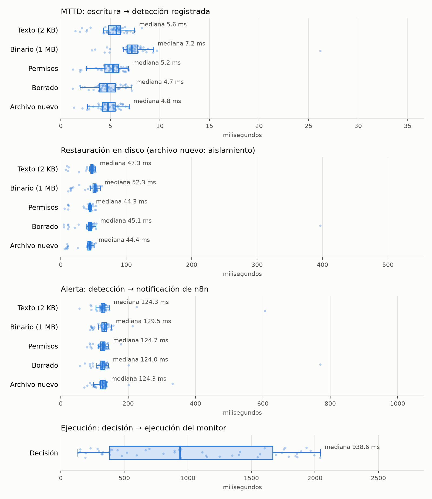

# CAPÍTULO 5: Resultados

Este capítulo presenta los resultados de las mediciones realizadas sobre el sistema FIM en su
versión final. Todos los valores provienen de archivos CSV generados por los scripts de medición
del proyecto (carpeta `scripts/`) y se informan tal como fueron registrados: no se descartaron
valores atípicos ni se repitieron corridas para mejorar los resultados. La fuente de cada tabla se
indica al pie. Los valores se expresan en milisegundos (ms) salvo que se indique otra unidad.

## 5.1 Condiciones de medición

Las mediciones se realizaron el 15 y el 16 de octubre de 2026 sobre una notebook con procesador
Intel Core 7 240H (16 procesadores lógicos), en Ubuntu ejecutado sobre el Subsistema de Windows
para Linux (WSL2, kernel 6.6.87.2), con Python 3.12.3, PostgreSQL 16.15, la biblioteca watchdog
6.0.0 y n8n 2.41.4 (fuente: `resultados/entorno_metricas_20261015_232407.json`).

Para no alterar el registro de auditoría real, las mediciones automatizadas se ejecutaron sobre una
base de datos separada (`fim_pruebas`), con el mismo esquema que la base productiva (`fim_db`), y con
una instancia de n8n de pruebas que envía las alertas a un servidor que simula la API de Telegram. Se
verificó que la base productiva `fim_db` no recibiera filas nuevas durante estas corridas: el
identificador máximo de su tabla `registros_archivos` fue 44 antes y después. La única excepción es una muestra de diez
alertas enviadas con el bot de Telegram real (sección 5.3), que sí quedó registrada en la base
productiva.

Las métricas se definieron de la siguiente manera, tomando como instante inicial `t0` el momento en
que el script de medición terminó de escribir el archivo:

- **MTTD (tiempo hasta la detección):** desde `t0` hasta la fila de detección en la base de datos.
  El valor registrado es el inicio de la transacción de inserción, por lo que incluye la notificación
  del kernel (inotify), el procesamiento de watchdog, el cálculo del hash y la consulta a la línea
  base.
- **MTTR (tiempo hasta la restauración):** desde `t0` hasta que el archivo vuelve a estar en disco
  como en la línea base. En el caso de un archivo nuevo, se mide el aislamiento: el instante en que el
  archivo deja de estar en el directorio vigilado porque fue movido a cuarentena.
- **Latencia de alerta:** desde la fila de detección hasta la fila en la tabla `notificaciones`, que
  n8n escribe después de que Telegram aceptó el mensaje.
- **Latencia de ejecución:** desde que una decisión se registra en la tabla `decisiones` hasta que el
  monitor la ejecuta y la registra en `ejecuciones`. No incluye el tiempo que tarda la persona en
  decidir.

Todas las marcas de tiempo provienen del mismo reloj, porque la base de datos y los scripts se
ejecutaron en el mismo equipo.

## 5.2 Detección y restauración automática

Se midieron cinco casos con 50 repeticiones cada uno: la modificación de un archivo de texto de
aproximadamente 2 KB, la reescritura de un archivo binario de 1 MB, el cambio de permisos de un
archivo (de 644 a 777), el borrado de un archivo y la creación de un archivo que no figura en la línea
base. El monitor operó en modo de restauración automática. Las 250 repeticiones produjeron todos los
valores esperados, sin datos faltantes.

**Tabla 5.1.** Tiempo hasta la detección (MTTD), en ms.

| Caso | Media | Mediana | p95 | Mínimo | Máximo |
|---|---:|---:|---:|---:|---:|
| Texto (2 KB) | 5,3 | 5,6 | 7,2 | 1,5 | 8,2 |
| Binario (1 MB) | 7,4 | 7,2 | 9,1 | 3,1 | 26,2 |
| Permisos | 5,0 | 5,2 | 6,6 | 1,2 | 6,8 |
| Borrado | 4,7 | 4,7 | 6,7 | 1,2 | 7,1 |
| Archivo nuevo | 4,8 | 4,8 | 6,2 | 1,3 | 6,9 |

*Fuente: `resultados/resumen_20261015_232407.md` (datos en `resultados/metricas_20261015_232407.csv`).*

La detección se registró en pocos milisegundos en todos los casos, con una mediana conjunta de
5,4 ms sobre las 250 repeticiones. El archivo binario es el caso más lento (mediana de 7,2 ms), lo
que es consistente con el mayor costo de calcular el hash SHA-256 de 1 MB frente a 2 KB.

**Tabla 5.2.** Tiempo hasta la restauración en disco (MTTR), en ms. Para el archivo nuevo, tiempo
hasta el aislamiento.

| Caso | Media | Mediana | p95 | Mínimo | Máximo |
|---|---:|---:|---:|---:|---:|
| Texto (2 KB) | 44,0 | 47,3 | 50,9 | 7,5 | 52,8 |
| Binario (1 MB) | 46,6 | 52,3 | 56,1 | 11,2 | 62,9 |
| Permisos | 41,3 | 44,3 | 50,8 | 5,7 | 54,1 |
| Borrado | 47,5 | 45,1 | 52,4 | 4,7 | 396,4 |
| Archivo nuevo (aislamiento) | 38,7 | 44,4 | 49,3 | 5,8 | 53,3 |

*Fuente: `resultados/resumen_20261015_232407.md`.*

La restauración tuvo una mediana conjunta de 45,4 ms. El tiempo hasta la fila `RESTAURADO` en la
base de datos resultó prácticamente igual al tiempo en disco (por ejemplo, 47,8 ms contra 47,3 ms
de mediana en el caso de texto), lo que confirma que el registro de la restauración se escribe
inmediatamente después de reponer el archivo.

**Origen de la diferencia entre detección y restauración.** La restauración tarda alrededor de
40 ms más que la detección. Durante la corrida de prueba se investigó la causa y se determinó que
corresponde a la confirmación (COMMIT) de la fila de detección en PostgreSQL: con la configuración
por defecto, el COMMIT espera a que el disco confirme la escritura del registro de transacciones.
El monitor guarda la evidencia antes de restaurar (decisión de diseño explicada en el Capítulo 4),
por lo que ese tiempo queda dentro del MTTR. Para dejarlo documentado con datos, se midió el COMMIT
de una fila en dos situaciones:

**Tabla 5.3.** Duración del COMMIT de PostgreSQL, en ms.

| Situación | Media | Mediana | p95 | Mínimo | Máximo |
|---|---:|---:|---:|---:|---:|
| Con el disco en reposo (pausa de 0,5 s entre COMMIT) | 35,3 | 37,9 | 42,4 | 3,2 | 44,2 |
| En ráfaga (sin pausa) | 1,9 | 1,8 | 3,1 | 1,1 | 4,0 |

*Fuente: `resultados/resumen_20261015_232407.md`.*

En el disco virtual de WSL2, el COMMIT tarda cerca de 38 ms cuando el disco viene de estar en
reposo y menos de 2 ms cuando las escrituras son seguidas. Esto explica también que la restauración
muestre dos grupos de valores: 30 de las 250 restauraciones tardaron menos de 20 ms, del mismo modo
que 5 de los 50 COMMIT en reposo tardaron menos de 20 ms. Este componente depende del almacenamiento
del equipo y no del FIM: en un servidor con disco nativo el valor sería distinto, algo que no se
midió en este trabajo.

## 5.3 Latencia de alerta

**Tabla 5.4.** Latencia de alerta con Telegram simulado (50 repeticiones por caso), en ms.

| Caso | Media | Mediana | p95 | Mínimo | Máximo |
|---|---:|---:|---:|---:|---:|
| Texto (2 KB) | 133,1 | 124,3 | 141,3 | 55,0 | 606,2 |
| Binario (1 MB) | 126,2 | 129,5 | 150,0 | 87,3 | 213,4 |
| Permisos | 122,3 | 124,7 | 138,6 | 77,5 | 178,6 |
| Borrado | 134,2 | 124,0 | 139,9 | 56,5 | 770,1 |
| Archivo nuevo | 125,2 | 124,3 | 136,3 | 69,8 | 331,9 |

*Fuente: `resultados/resumen_20261015_232407.md`.*

Con Telegram simulado, el tramo que agregan n8n y la base de datos tuvo una mediana de alrededor de
125 ms en todos los casos. Este valor no incluye el viaje hasta los servidores de Telegram. Para
medirlo se tomó una muestra de diez alertas con el bot real, sobre la instalación de uso diario:

**Tabla 5.5.** Muestra con el bot de Telegram real (10 repeticiones), en ms.

| Métrica | Media | Mediana | p95 | Mínimo | Máximo |
|---|---:|---:|---:|---:|---:|
| Tiempo hasta la detección | 8,2 | 5,2 | 23,5 | 2,7 | 35,2 |
| Restauración en disco | 37,3 | 47,4 | 51,5 | 6,7 | 52,5 |
| Latencia de alerta | 1108,1 | 1105,4 | 1258,6 | 983,2 | 1294,0 |

*Fuente: `resultados/resumen_telegram_real_20261016_000516.md` (datos en
`resultados/alerta_telegram_real_20261016_000516.csv`).*

Sumando detección y alerta, el tiempo desde la escritura del archivo hasta que Telegram confirmó la
entrega del mensaje tuvo una mediana de 1,11 s, con valores entre 0,99 y 1,30 s (fuente:
`resultados/README.md`, sección 2). La diferencia de aproximadamente un segundo respecto de la
alerta simulada corresponde a la comunicación con la API de Telegram. Las diez alertas fueron
cerradas como incidente desde el teléfono, y las diez decisiones quedaron registradas y ejecutadas.
Al tratarse de una muestra de diez repeticiones, estos valores deben leerse como un orden de
magnitud y no como una estimación precisa.

## 5.4 Ejecución de decisiones

Se midieron 50 decisiones (alternando "Fue un incidente" y "Era un cambio autorizado"), insertadas
directamente en la tabla `decisiones` del mismo modo en que lo hace n8n. Para evitar un sesgo de
medición, cada decisión se insertó después de una espera aleatoria de entre 0 y 2 s: el monitor busca
decisiones nuevas cada 2 s, y si todas se insertaran en el mismo punto de ese ciclo se mediría
siempre la misma espera. Las 50 decisiones se ejecutaron correctamente.

**Tabla 5.6.** Latencia de ejecución de decisiones (50 repeticiones), en ms.

| Media | Mediana | p95 | Mínimo | Máximo |
|---:|---:|---:|---:|---:|
| 1013,7 | 938,6 | 1951,7 | 133,7 | 2041,5 |

*Fuente: `resultados/resumen_20261015_232407.md`.*

La distribución es la esperable para una consulta periódica cada 2 s: 27 decisiones se ejecutaron en
menos de 1 s, 22 entre 1 y 2 s, y una en 2041,5 ms, apenas por encima del período de consulta por el
tiempo de procesamiento. En consecuencia, una vez que la persona decide, el sistema tarda en promedio
alrededor de un segundo en aplicar la decisión. El tiempo humano de decisión no forma parte de esta
medición.

## 5.5 Falsos positivos con editores reales

Para evaluar el efecto del filtro de archivos temporales se editaron archivos vigilados con dos
editores de texto reales, vim 9.1 y nano 7.2, controlados mediante una pseudoterminal que envía las
pulsaciones de teclado (agregar una línea al final, guardar y salir). Se realizaron 20 ediciones con
cada editor en dos corridas: con el filtro de temporales activo y sin él. Se consideró alerta
esperada la primera detección `MODIFICADO` del archivo editado, y espuria cualquier otra.

**Tabla 5.7.** Alertas por corrida y editor (20 ediciones por editor).

| Corrida | Editor | Alertas | Esperadas | Espurias | Tasa de falsos positivos |
|---|---|---:|---:|---:|---:|
| Con filtro | vim | 20 | 20 | 0 | 0,0 % |
| Con filtro | nano | 20 | 20 | 0 | 0,0 % |
| Sin filtro | vim | 40 | 20 | 20 | 50,0 % |
| Sin filtro | nano | 60 | 20 | 40 | 66,7 % |

*Fuente: `resultados/resumen_falsos_positivos_20261015_233331.md` (datos en
`resultados/falsos_positivos_20261015_233331.csv`). Tasa de falsos positivos = alertas espurias /
alertas totales.*

Sin el filtro, todas las alertas espurias correspondieron a los archivos de intercambio que crean
los editores: `.vim.conf.swp` en el caso de vim (una por edición) y `.nano.conf.swp` en el caso de
nano (dos por edición). Con el filtro activo no se registró ninguna alerta espuria. En las 80
ediciones los editores guardaron el cambio y terminaron correctamente. Las ediciones se hicieron sin
configuración personal, por lo que rigió la del sistema: en Ubuntu, el archivo `/etc/nanorc` activa la
opción de bloqueo (`set locking`), que es la que crea los archivos `.swp` de nano, y vim guarda
sobre el mismo archivo (`backupcopy=yes`), por lo que no se observaron renombrados intermedios.

Estos valores describen un caso controlado con dos editores y no la tasa de falsos positivos de un
servidor en producción, donde intervienen otros procesos (actualizaciones de paquetes, rotación de
registros, etc.). Además, el filtro tiene un costo: un archivo malicioso cuyo nombre coincida con un
patrón ignorado no se detecta, limitación que se retoma en el Capítulo 6.

## 5.6 Comparación con un escaneo periódico

Para contrastar el monitoreo por eventos con el enfoque de escaneo periódico (como el que se
programa con `cron`), se midió primero cuánto tarda un escaneo completo. Se copiaron los archivos
legibles de `/etc` (719 archivos, 1,1 MB) y se recorrieron 20 veces calculando, para cada archivo, el
hash SHA-256, los permisos y el propietario, con las mismas funciones que usa el FIM. La duración del
escaneo completo (S) tuvo una mediana de 9,7 ms, con un p95 de 10,6 ms y valores entre 9,2 y 11,5 ms
(fuente: `resultados/resumen_escaneo_periodico_20261015_235418.md`).

Si el escaneo se ejecuta cada T segundos y un cambio ocurre en un instante cualquiera, el cambio
espera en promedio T/2 hasta el siguiente escaneo, y como máximo T, a lo que se suma la duración
del escaneo. La detección esperada es entonces de aproximadamente T/2 + S en promedio y T + S como
máximo. Para validar esta estimación se ejecutó un escáner real con un período de 10 s y se
realizaron 30 cambios en instantes aleatorios: la detección media medida fue de 4,45 s (mediana de
4,29 s, máximo de 9,10 s), frente a los 5,01 s que predice la fórmula. La diferencia es compatible
con la variabilidad esperable en una muestra de 30 cambios.

**Tabla 5.8.** Detección estimada para distintos períodos de escaneo, con el S medido.

| Período T | Detección media ≈ T/2 + S | Detección máxima ≈ T + S |
|---|---:|---:|
| 10 s (validado con medición) | 5,0 s | 10,0 s |
| 1 min | 30,0 s | 60,0 s |
| 5 min | 150,0 s | 300,0 s |
| 1 h | 1800,0 s | 3600,0 s |

*Fuente: `resultados/resumen_escaneo_periodico_20261015_235418.md`. Para T de 1 min, 5 min y 1 h los
valores son un cálculo, no una medición.*

Frente a estos valores, el monitor por eventos registró la detección con una mediana de 5,4 ms
(sección 5.2). La ventaja no proviene de un escaneo más rápido, ya que recorrer 719 archivos lleva
menos de 12 ms, sino de que el monitor no espera al siguiente ciclo: reacciona a la notificación del
kernel en el momento del cambio.

## 5.7 Comparación con la tabla del documento de diseño

El documento de diseño de la etapa de orquestación ("Orquestación de Playbooks para Monitoreo de
Integridad de Archivos (FIM) con n8n") incluía una tabla de resultados que, según el propio
documento, era simulada: sus valores fueron supuestos y no medidos. Se reproduce junto a los valores
medidos en este trabajo únicamente para dejar en claro la diferencia entre ambos.

**Tabla 5.9.** Valores supuestos en el documento de diseño frente a valores medidos.

| Métrica | Documento de diseño, manual (supuesto) | Documento de diseño, con n8n (supuesto) | Este trabajo (medido, medianas) |
|---|---:|---:|---|
| Tiempo hasta la detección | 12 min | 4 min | 5,4 ms hasta registrar la detección; 1,11 s hasta la alerta en Telegram |
| Tiempo hasta la restauración | 45 min | 25 min | 45,4 ms en modo de restauración automática |
| Tasa de falsos positivos | 10 % | 5 % | 0 % con el filtro de temporales; 50,0 % (vim) y 66,7 % (nano) sin él |

*Fuentes: tabla de resultados del documento de diseño (valores supuestos) y `resultados/README.md`,
sección 5 (valores medidos).*

No se calcula un porcentaje de mejora porque las definiciones no son equivalentes. El documento de
diseño medía el tiempo de restauración a partir de la alerta y suponía una aprobación humana previa;
en el modo de aprobación de este sistema, ese tiempo depende de la persona y no fue medido. Lo que sí
se midió es el tiempo que agrega el sistema una vez tomada la decisión (mediana de 938,6 ms,
sección 5.4). La tasa de falsos positivos medida corresponde, como se señaló, a un caso controlado
con dos editores.

## 5.8 Valores atípicos y amenazas a la validez

Los valores atípicos se mantuvieron en los datos. Los más relevantes son:

- **Repetición 49 de la corrida principal.** En esa repetición se demoraron a la vez varias
  operaciones independientes entre sí. De los 15 valores medidos en ella, cuatro son el máximo de su
  caso en las 50 repeticiones (Tabla 5.10), y corresponden a dos subsistemas distintos: la
  restauración en disco, que depende del COMMIT de PostgreSQL y de la copia del archivo, y la
  entrega de la alerta, que depende de n8n. En cambio, las detecciones de esa misma repetición
  fueron normales (2,4 ms en el borrado y 2,8 ms en el archivo nuevo, ambas por debajo de la
  mediana), y la repetición de permisos, ejecutada entre la del binario y la del borrado, tampoco
  mostró demoras.

  **Tabla 5.10.** Valores de la repetición 49 que fueron el máximo de su caso.

  | Caso | Medición | Repetición 49 | Mediana de las 50 |
  |---|---|---:|---:|
  | Binario (1 MB) | Latencia de alerta | 213,4 | 129,5 |
  | Borrado | Restauración en disco | 396,4 | 45,1 |
  | Borrado | Latencia de alerta | 770,1 | 124,0 |
  | Archivo nuevo | Latencia de alerta | 331,9 | 124,3 |

  *Fuente: `resultados/metricas_20261015_232407.csv` (repetición 49) y
  `resultados/resumen_20261015_232407.md` (medianas).*

  Este patrón (detección normal y demoras simultáneas en procesos que no comparten código) es
  consistente con una pausa del entorno, por ejemplo del disco virtual de WSL2. La causa exacta no
  se verificó, porque durante la corrida no se registraron métricas del sistema operativo. Los
  valores se mantienen en los datos y en todos los estadísticos del capítulo.
- La primera alerta de la corrida tardó 606,2 ms, frente a una mediana de 124,3 ms en ese caso. Es
  consistente con la primera ejecución del flujo de trabajo en n8n, que debe inicializarse.
- En la corrida principal, una detección del caso binario tardó 26,2 ms (mediana de 7,2 ms) y, en la
  muestra con Telegram real, una detección tardó 35,2 ms (mediana de 5,2 ms).

Además, deben tenerse en cuenta las siguientes amenazas a la validez de los resultados:

- **Entorno:** las mediciones se hicieron en una sola notebook con WSL2. El MTTR está dominado por el
  COMMIT de PostgreSQL en el disco virtual (sección 5.2), por lo que los tiempos absolutos de
  restauración no son extrapolables a un servidor con otro almacenamiento.
- **Escala:** el directorio vigilado contenía pocos archivos y los cambios se hicieron de a uno. No se
  evaluaron ráfagas de cambios simultáneos ni directorios con miles de archivos.
- **Telegram:** la latencia de alerta real se midió con solo diez repeticiones y depende de la red y
  de un servicio externo.
- **Falsos positivos:** se evaluaron dos editores en un caso controlado; no se midió la carga de
  falsos positivos de un sistema en operación.
- **Modo de restauración:** las mediciones de MTTR corresponden al modo automático. En el modo de
  aprobación, la restauración depende del tiempo de respuesta humano.

La Figura 5.1 resume la distribución de las mediciones de la corrida principal.

**Figura 5.1.** Distribución por caso del tiempo hasta la detección, la restauración en disco, la
latencia de alerta (Telegram simulado) y la ejecución de decisiones. Cada punto es una repetición;
las cajas indican el rango intercuartil y la mediana. Cada panel tiene su propia escala. Fuente:
`resultados/grafico_20261015_232407.png`.
